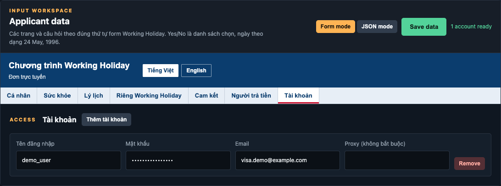

# Cách dùng INZ Runner

Bản in đủ hình là [packaging/HUONG_DAN_SU_DUNG.pdf](packaging/HUONG_DAN_SU_DUNG.pdf). Mac Apple Silicon mở `INZ-Runner-Mac.dmg`. Windows 10 và 11, 64-bit, mở `INZ-Runner-Setup.exe`. Máy cần có Google Chrome.

Ảnh chụp màn hình hiện tại. Thanh trên ảnh để tiếng Anh: **Run**, **Runner log**, **Applicant data**, **Settings**. Form đơn để tiếng Việt. Số liệu trong ảnh là hồ sơ mẫu.

## App làm gì

Tool đăng nhập, điền đơn Working Holiday và bấm tiếp đến trang thanh toán. Bạn tự nhập thẻ.

- Thẻ quốc gia đang **CLOSED** thì tool tải lại danh sách và chờ **OPEN**.
- Trang cuối có câu `no longer a place available for you` thì tool tải lại đúng trang đó, không quay về danh sách. Có nút **Submit** thì bấm Submit.
- Trang quá tải thì tool tải lại và thử tiếp.
- Captcha chậm vẫn được chờ. Màn chạy hiện **Đã giải captcha** khi xong.

## Điền đơn

Vào **Applicant data**. Giữ **Form mode**. Bấm **Save data**. Dấu **!** là ô bắt buộc. Dòng xanh **Có thể để trống** thì được bỏ trống. Ngày viết dạng `24 May, 1996`.

Ảnh mẫu dùng Nguyen, Thi Mai An, email `visa.demo@example.com`. Thay bằng giấy tờ của bạn.

### Cá nhân

Ảnh điền: cố vấn di trú `No (Không)`, họ `Nguyen`, tên 1 `Thi Mai An`, danh xưng `Miss (Cô)`, giới tính `Female (Nữ)`, ngày sinh `24 May, 1996`, nước sinh `Vietnam`. Địa chỉ `12` / `Le Loi` / `Quan 1` / `Ho Chi Minh` / `700000` / `Vietnam`. Ba số điện thoại `0901234567`. Email `visa.demo@example.com`. Cách liên hệ `Email`. Có thẻ để nộp phí: `Yes (Có)`.

### Giấy tờ

Hai ô số hộ chiếu cùng là `C1234567`. Hết hạn `8 September, 2033`. Quốc tịch `Vietnam`. Giấy tờ thứ hai là `National ID (Căn cước công dân)`, cấp `26 September, 2024`, hết hạn `26 September, 2034`. Hộ chiếu phải còn hạn trên 6 tháng.

### Nghề nghiệp

Ảnh điền `Banking` và `Bank officer`. Trang này được để trống nếu không có lựa chọn phù hợp.

### Sức khỏe

Tám câu đầu trên ảnh là `No (Không)`. Câu ở từ 3 tháng tại nước không thuộc nhóm ít nguy cơ lao là `Yes (Có)` vì Việt Nam thuộc nhóm nguy cơ lao cao. Khung chi tiết để trống. Có bệnh thật thì phải ghi vào khung đó.

### Lý lịch

Ảnh chọn `No (Không)` hết chín câu. Từng có án, bị trục xuất hoặc bị từ chối nhập cảnh thì chọn Có đúng câu đó và ghi ngày cùng quốc gia.

### Riêng Working Holiday

Ô quốc gia trên ảnh là `VIETNAM`. Ô này và **Scheme country** trong Settings phải cùng một chữ.

| Câu | Ảnh đang chọn |
| --- | --- |
| Đã từng được cấp visa Working Holiday New Zealand | `No (Không)` |
| Đủ tiền cho chuyến | `Yes (Có)`, chỉ khi đủ mức của đúng chương trình |
| Ngày dự định đến | `24 December, 2026` |
| Đã từng đến New Zealand | `No (Không)` |
| Đủ tiền mua vé rời New Zealand | `Yes (Có)` |
| Đủ điều kiện riêng của chương trình | `Yes (Có)` |
| Thời gian dự định ở lại | Để `Chọn` nếu trang không hỏi |

### Cam kết

Tick đủ 11 ô. Mỗi ô lưu `Yes`.

### Người trả tiền

Ảnh chỉ lưu tên chủ thẻ `Thi Mai An Nguyen`. Không có ô số thẻ.

### Tài khoản

Trong Applicant data, tab **Tài khoản**. Ảnh có một dòng: `demo_user`, mật khẩu, email `visa.demo@example.com`, ô Proxy để trống. Bấm **Thêm tài khoản**, rồi **Save data**. Góc phải hiện `1 account ready`.

## Settings

- **Scheme country** trên ảnh là `VIETNAM`. Bấm **Save settings**.
- **Whitelist Google Sheet**: `yes` chỉ cho username trong danh sách, `no` thì username nào cũng chạy.
- Ba ô CapMonster, bot token và chat ID trên ảnh đang là chữ gợi ý. Giá trị dùng khi chạy lấy từ sheet. Thiếu một giá trị thì lần chạy dừng.
- **Send test** gửi tin thử Telegram.

## Chạy

Bấm **Start runner**.

- **Stop app** dừng và giữ nguyên trang. **Resume** chạy tiếp. **Cancel** đóng Chrome của lần chạy.
- Ảnh đang chạy: Account 1 ở trang Sức khỏe, **Đã giải captcha**, **Đã điền 3**. Cột STATUS là `Captcha solved`.
- Khung tiến độ chỉ đọc log đã in.

Sang Applicant data lúc đang chạy: trang đã qua có chấm xanh, ô đã điền nền xanh và chữ **Đã điền**.

Khi trang cuối báo `no longer a place available for you`, để tool tải lại trang đó. Có nút Submit thì tool bấm. Không quay về danh sách quốc gia.

Tới trang thanh toán thì tool lưu link và đóng Chrome. Bạn tự trả. Số tiền là số đang hiện trên trang thanh toán.
