# Cách dùng INZ Runner

Cài app theo [CAI_DAT.pdf](CAI_DAT.pdf). Bản in đủ hình và ví dụ điền đơn là [packaging/HUONG_DAN_SU_DUNG.pdf](packaging/HUONG_DAN_SU_DUNG.pdf). File cài Windows là `INZ-Runner-Setup.exe`, bản 64-bit, dùng trên Windows 10 và 11. Máy Windows chip ARM vẫn mở được file này.

Hướng dẫn này đi theo thứ tự form Working Holiday trên trang Immigration New Zealand. Tool điền đơn và bấm tiếp. Bạn chuẩn bị dữ liệu một lần, rồi bấm chạy khi quốc gia trên trang đang **OPEN**.

App có bốn tab: **Chạy**, **Nhật ký**, **Hồ sơ**, **Cài đặt**.

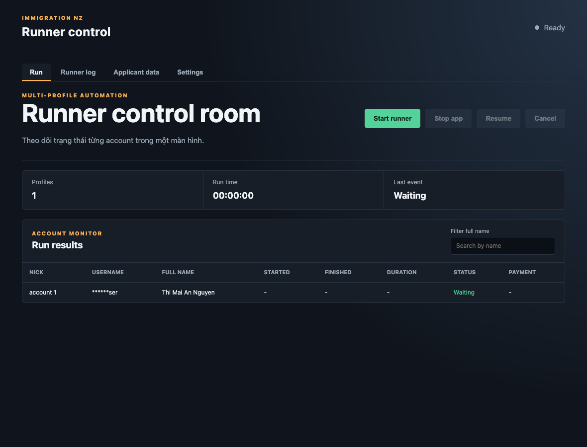

## Điền đơn

Vào **Hồ sơ**. Giữ chế độ **Form**. Câu hỏi để tiếng Việt, giá trị lưu vẫn là chữ của website: `Yes`, `No`, `Miss`, `Female`, `National ID`. Ngày viết đúng dạng `24 May, 1996`.

Dấu **!** là ô website bắt buộc. Dòng xanh **Có thể để trống** thì được bỏ trống. Bấm **Lưu hồ sơ** sau khi điền.

### Cá nhân

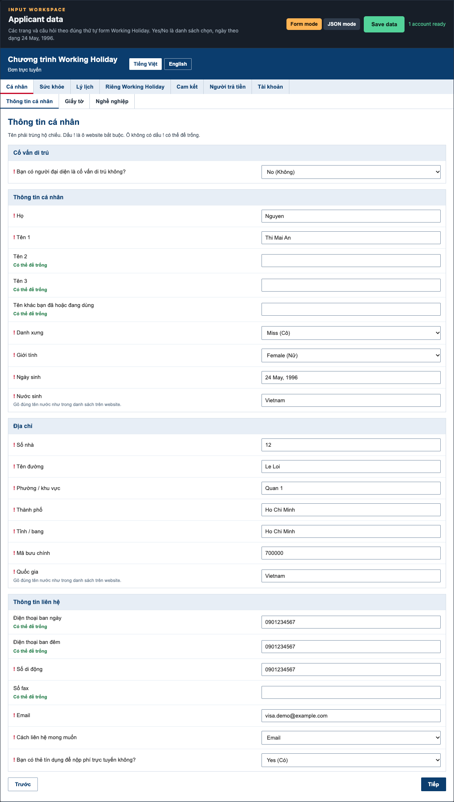

Điền các ô sau cho khớp form trên website:

| Trên website | Ô trong tool |
| --- | --- |
| Họ | **Họ** |
| Chữ lót và tên viết chung một ô. Đừng tách sang Tên 2, Tên 3 vì dễ lẫn thứ tự | **Tên 1**. Để trống Tên 2 và Tên 3 |
| Danh xưng ông, bà hoặc cô | **Danh xưng**. Ví dụ `Miss (Cô)` |
| Nam hoặc nữ | **Giới tính** |
| Ngày tháng năm sinh | **Ngày sinh** |
| Nước sinh ra | **Nước sinh**. Gõ đúng chữ trong danh sách website, ví dụ `Vietnam` |
| Số nhà, tên đường | **Số nhà**, **Tên đường** |
| Ở nước ngoài, ô kiểu làng xã không được trống. Ở thành phố thì điền tên thành phố hoặc quận vào ô đó | **Phường / khu vực** |
| Thành phố, mã bưu chính, quốc gia | **Thành phố**, **Tỉnh / bang**, **Mã bưu chính**, **Quốc gia**. Điền mã đúng địa chỉ của bạn nếu có |
| Một số điện thoại, copy vào cả ba ô cho nhanh | **Điện thoại ban ngày**, **Điện thoại ban đêm**, **Số di động**. Trong tool, ban đêm và fax được để trống. Số di động là bắt buộc |
| Email nhận tin visa, phải điền đúng | **Email** |
| Tự nộp, không qua tư vấn định cư | **Bạn có người đại diện là cố vấn di trú không?** chọn `No (Không)` |
| Muốn được liên hệ bằng email | **Cách liên hệ mong muốn** chọn `Email` |
| Thanh toán bằng thẻ Visa hoặc Mastercard | **Bạn có thẻ tín dụng để nộp phí trực tuyến không?** chọn `Yes (Có)` |

Tool không lưu số thẻ.

### Giấy tờ

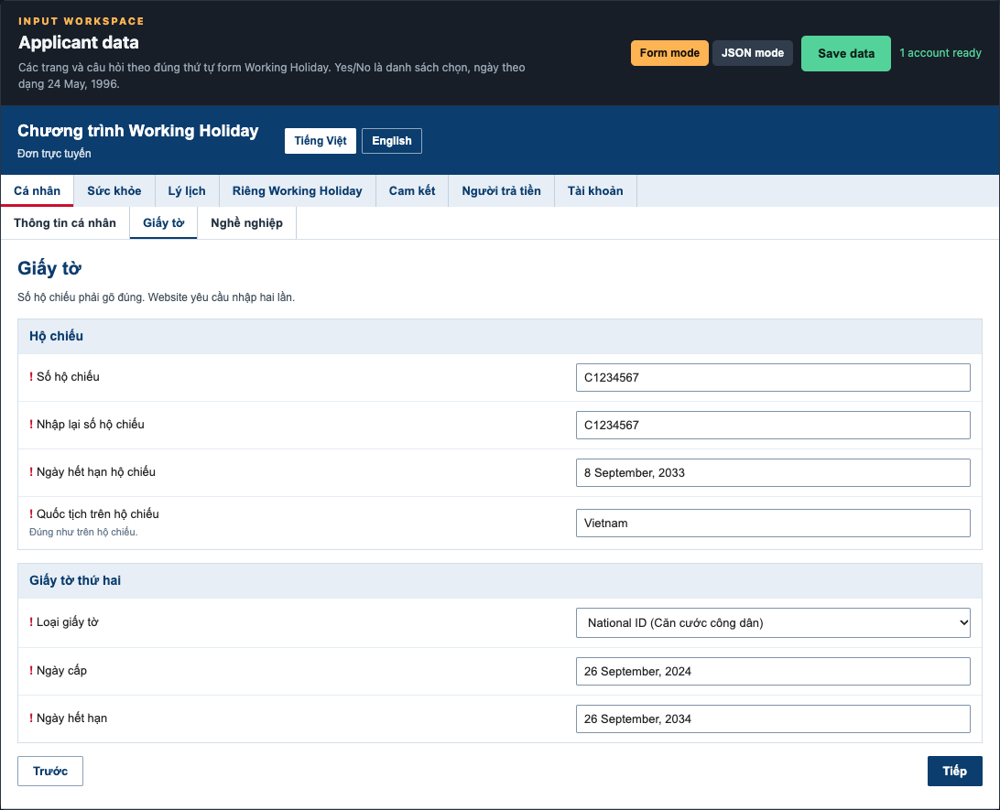

- Hộ chiếu còn hạn ít nhất 6 tháng.
- **Số hộ chiếu** gõ đúng, rồi gõ lại ở **Nhập lại số hộ chiếu**. Hai ô phải giống nhau thì mới lưu được.
- **Ngày hết hạn hộ chiếu**.
- **Quốc tịch trên hộ chiếu** là nước trên hộ chiếu của bạn. Hồ sơ Việt Nam điền `Vietnam`.
- Giấy tờ thứ hai: chọn căn cước nếu bạn dùng căn cước. Trong tool chọn `National ID (Căn cước công dân)`, rồi điền **Ngày cấp** và **Ngày hết hạn**. Có thể chọn giấy khai sinh hoặc bằng lái nếu đó mới là giấy bạn dùng.

### Nghề nghiệp

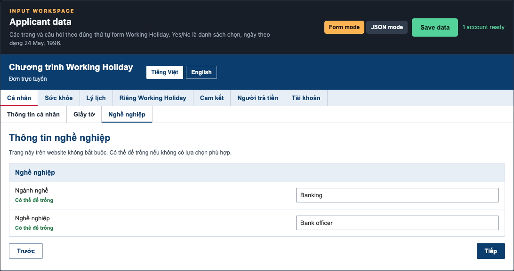

Chọn ngành và nghề gần với công việc chính nhất, không cần thật chính xác. Nếu làm nhiều việc, ghi việc chiếm nhiều thời gian nhất trong 12 tháng. Không đi làm 12 tháng thì dùng việc trước đó. Không đi làm từ 5 năm trở lên thì chọn mục tương đương “không đề cập”.

Trong tool hai ô **Ngành nghề** và **Nghề nghiệp** được để trống. Runner hiện không gõ hai ô tìm kiếm này trên website. Trang đó được bấm Next và đi tiếp.

### Sức khỏe

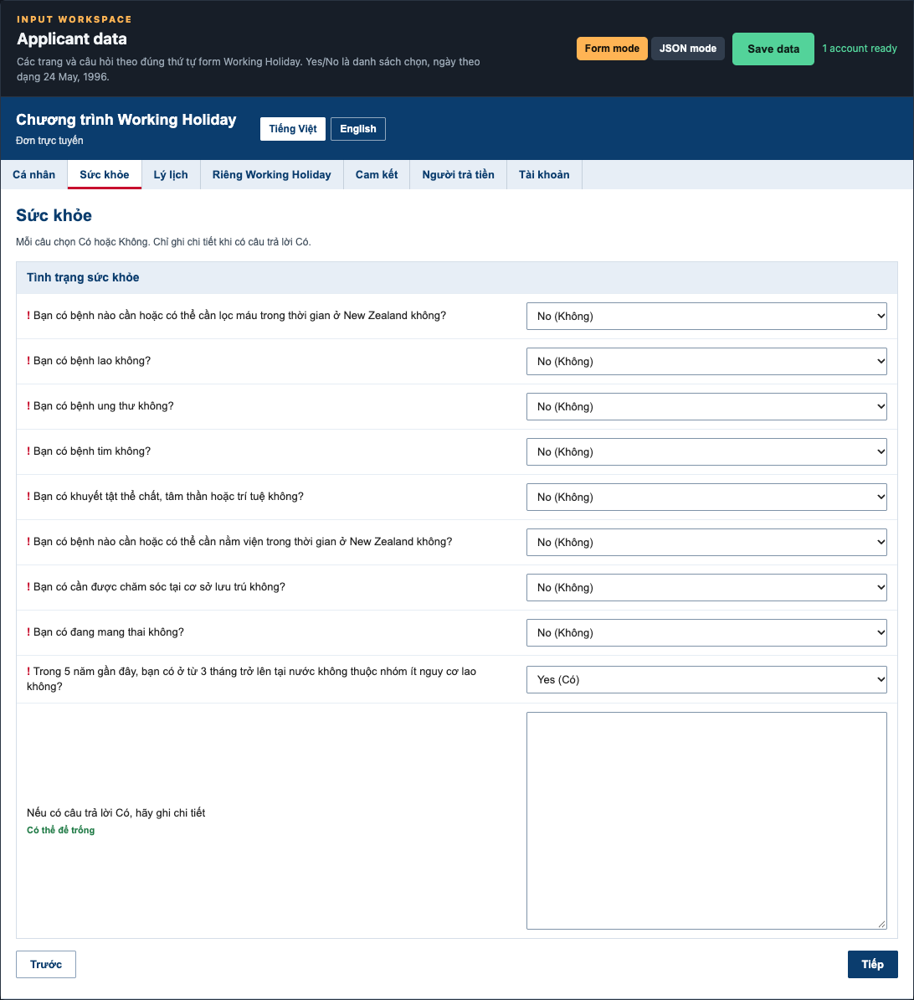

Chọn **Không** cho các câu về lọc máu, lao, ung thư, tim, khuyết tật, nằm viện, chăm sóc tại chỗ và mang thai.

Câu ở từ 3 tháng trở lên trong 5 năm tại nước không thuộc nhóm ít nguy cơ lao: Việt Nam nằm trong nhóm nguy cơ lao cao. Nếu bạn sống ở Việt Nam, chọn `Yes (Có)`.

Chỉ ghi **Nếu có câu trả lời Có, hãy ghi chi tiết** khi có ít nhất một câu Yes mà website yêu cầu giải thích. Câu nguy cơ lao không cần ghi thêm vào khung chi tiết.

### Lý lịch

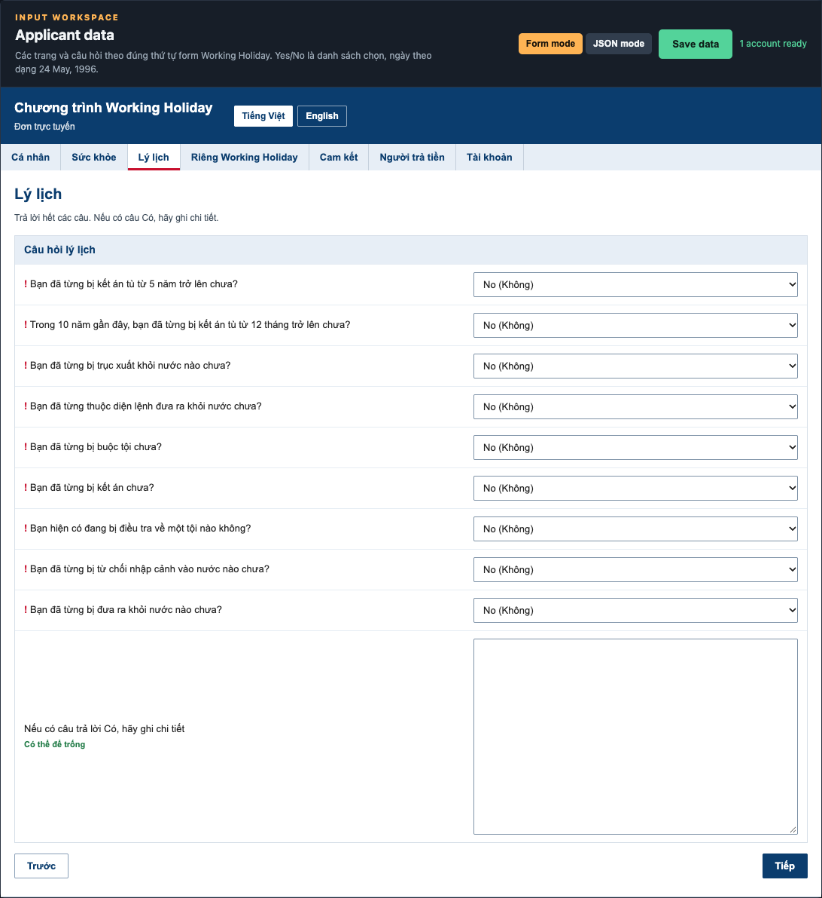

Trang này khai bạn chưa từng phạm tội, ngồi tù hoặc bị trục xuất. Câu nào không rõ thì dịch câu đó. Nếu chưa từng, chọn `No (Không)` hết. Nếu từng có, phải ghi ngày và quốc gia vào ô chi tiết. Không được để Yes mà bỏ trống phần giải thích.

### Riêng Working Holiday

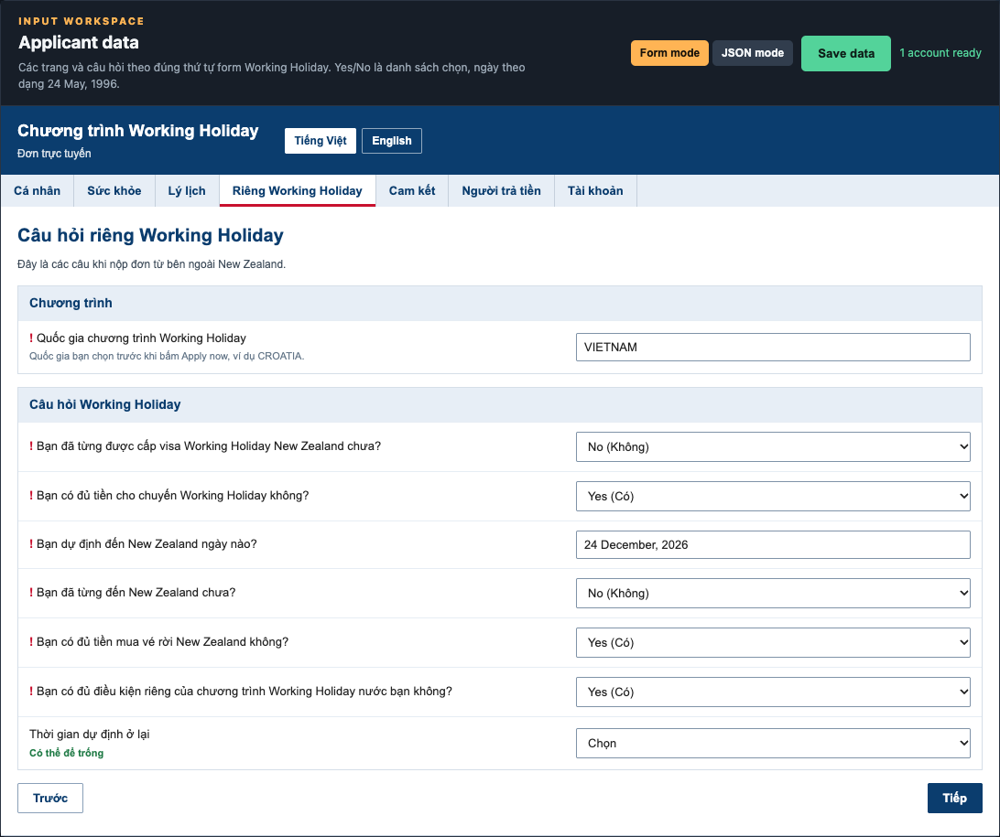

**Quốc gia chương trình Working Holiday** là nước bạn bấm trên danh sách trước Apply now. Xem trang Immigration để biết đợt nào đang mở. Điền đúng chữ trên thẻ, ví dụ `VIETNAM` hoặc `JAPAN`. Ô này và **Scheme country** trong Settings phải giống nhau.

| Câu trên website | Cách chọn |
| --- | --- |
| Đã từng được cấp visa Working Holiday New Zealand chưa | `No (Không)` nếu chưa |
| Có đủ tiền cho chuyến không | `Yes (Có)` chỉ khi đủ mức của đúng chương trình. Scheme Việt Nam yêu cầu 4.200 đô New Zealand, khoảng 63 đến 70 triệu đồng. Nước khác có mức khác. Xem điều kiện của nước bạn chọn trước khi bấm Có |
| Ngày dự định đến | **Bạn dự định đến New Zealand ngày nào?** |
| Đã từng đến New Zealand chưa | `No (Không)` nếu chưa. Nếu `Yes`, điền thêm ngày ở ô hiện ra |
| Đủ tiền mua vé rời New Zealand khi visa hết hạn | `Yes (Có)` |
| Đủ điều kiện riêng của chương trình nước mình | `Yes (Có)` |
| Thời gian dự định ở lại | Để trống nếu trang không hỏi. Một số scheme có `6 months` hoặc `12 months` |

### Cam kết

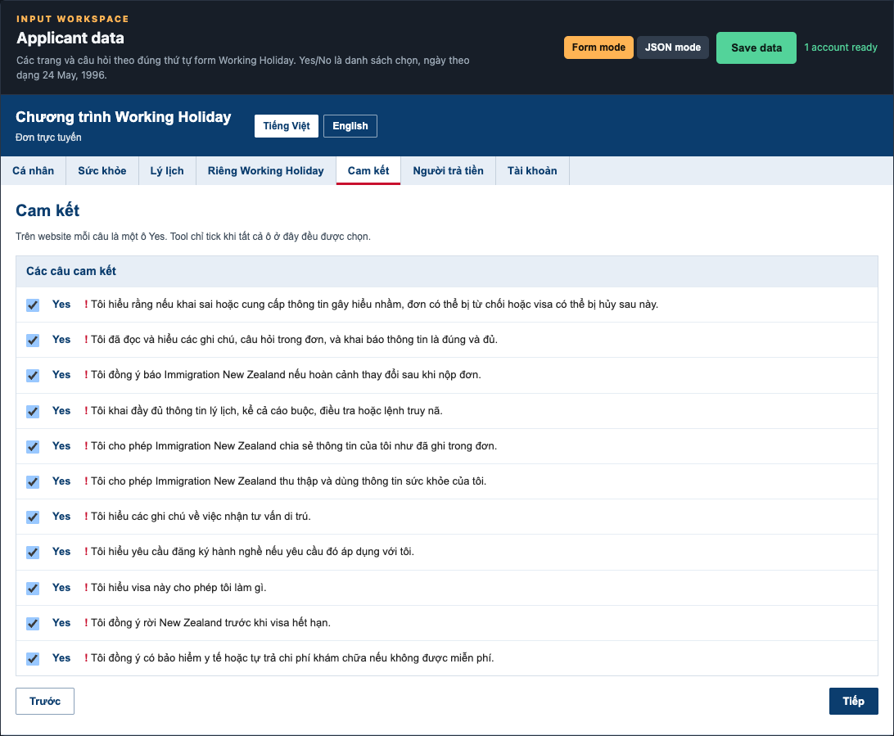

Trên website, mỗi câu cam kết là một ô Yes: đã đọc quy định và hiểu visa cho phép làm gì. Trong tool, tick hết 11 ô. Chữ `Yes` bên cạnh mỗi câu là giá trị sẽ lưu. Runner chỉ tick các ô trên website khi tất cả đều được chọn.

### Người trả tiền

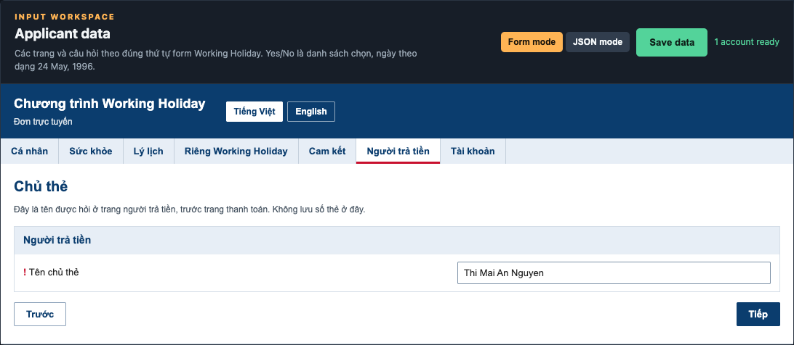

Trên website bấm **Pay now**, rồi điền tên người trả. **Tên chủ thẻ** là tên của bạn. Phí visa là 670 đô New Zealand và tăng theo năm. Số trên trang thanh toán lúc bạn nộp là số phải trả.

Tool dừng trước trang nhập thẻ. Bạn tự điền số thẻ, ngày hết hạn và mã bảo mật trên trang Paystation.

### Tài khoản đăng nhập

Tài khoản nằm ở tab **Cài đặt**, phía dưới danh sách proxy. Mỗi dòng là một Chrome riêng:

- **Tên đăng nhập** và **Mật khẩu** là tài khoản Immigration vừa tạo.
- **Email** là email nhận tin visa. Nếu email trong đơn trống, tool lấy email của dòng này.
- **Dùng proxy**: tick nếu tài khoản này lấy dòng tiếp theo trong danh sách proxy. Không tick thì chạy trực tiếp.

Bấm **Lưu cài đặt**. Dòng trạng thái ở Hồ sơ phải báo số tài khoản sẵn sàng thì mới chạy được. Nếu form và Settings ghi hai quốc gia khác nhau, tool không chạy.

## Settings

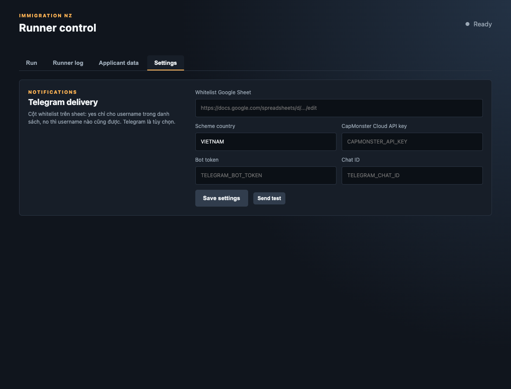

- **Scheme country** trùng ô quốc gia trong đơn. Runner chỉ bấm Apply now khi thẻ đó hiện OPEN. Nếu đang đóng, tool refresh và chờ. **Tạm dừng** hoặc **Huỷ** thì ngừng refresh.
- **Danh sách proxy**: mỗi dòng một proxy `host:port:username:password`. Tài khoản tick **Dùng proxy** lấy lần lượt từ trên xuống.
- **Whitelist Google Sheet** có cột `whitelist`: `yes` chỉ cho username trong danh sách chạy, `no` thì username nào cũng chạy.
- Cùng sheet đó phải có cột `api_key`, `bot_token` và `chat_id`. Tool chỉ lấy ba giá trị này từ sheet. Tab Cài đặt không có ô để thêm, sửa hay xóa. Thiếu API key, bot token hoặc chat ID thì lần chạy dừng và log ghi `không có giá trị`.
- **Autocaptcha API key** để giải ảnh reCAPTCHA. Trên website tool tự bấm ô “không phải người máy”, gửi ảnh cho Autocaptcha, rồi Submit. Kết quả hiện trên màn Chạy.
- **Bot token** và **Chat ID** để nhận tin Telegram khi một account chạy xong.

Chữ mờ trong ô trống là gợi ý, không phải giá trị đã lưu.

## Chạy và theo dõi

Quay lại tab **Chạy**, bấm **Bắt đầu**.

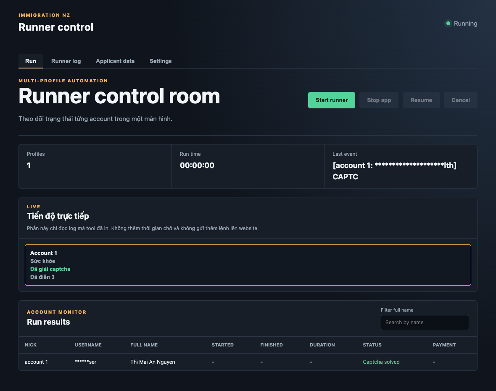

- **Bắt đầu** mở Chrome và chạy.
- **Tạm dừng** dừng account đang chạy, kể cả lúc đang refresh quốc gia, lúc web quá tải và lúc đang giải captcha. Đồng hồ đứng lại. Chrome giữ nguyên trang. **Tiếp tục** chạy tiếp từ chỗ đó.
- **Huỷ** đóng hết Chrome và xóa tiến độ, log, đồng hồ trên màn Chạy. Đóng cửa sổ app trong lúc chạy cũng đóng Chrome. Dữ liệu đơn đã lưu vẫn còn. Bấm **Bắt đầu** khi muốn chạy lại.
- Nếu sau đăng nhập trang hiện danh sách hồ sơ cũ, với Edit, Submit và Delete, tool dừng ngay. Nó không bấm các nút đó. Chrome được giữ lại để bạn tự xử lý.
- **Tiến độ trực tiếp** chỉ đọc log tool đã in. Nó không thêm lệnh và không thêm thời gian chờ trên website.
- Captcha có ba trạng thái: **Đang giải captcha**, **Đã giải captcha**, **Giải captcha không xong**.
- Số **Đã điền** là số ô tool đã ghi trên trang hiện tại.

Sang tab **Hồ sơ** trong lúc chạy, trang đang mở có chấm vàng, trang đã qua có chấm xanh. Ô đã điền nền xanh và chữ **Đã điền**. Ô không thấy trên trang nền đỏ và chữ **Không thấy trên trang**.

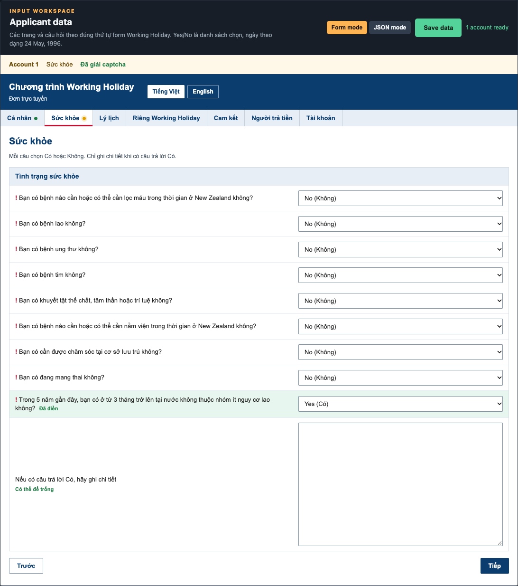

Tab **Nhật ký** là log đầy đủ của lần này và các lần trước.

Khi xong, bảng kết quả có nút **Mở trang thanh toán**. Bấm nút đó để tự trả. Tool không điền thẻ. Chrome đóng sau khi dừng ở trang thanh toán.

## Sau khi nộp

Email xác nhận sẽ yêu cầu giấy tờ kèm, ví dụ bằng cấp hoặc chứng chỉ tiếng Anh. Khám sức khỏe và lấy dấu vân tay là bước sau, không nằm trong tool này.

## Việc cần nhớ trước giờ mở đơn

- Tài khoản Immigration đã xác nhận email. Tên đăng nhập và mật khẩu đã nằm trong tab Tài khoản.
- Tên 1 gồm chữ lót và tên. Họ nằm ở ô Họ.
- Phường / khu vực không để trống.
- Hộ chiếu còn hạn trên 6 tháng. Hai ô số hộ chiếu giống nhau. Quốc tịch đúng nước trên hộ chiếu.
- Sống ở Việt Nam thì câu nguy cơ lao là Có.
- Có đủ tiền đúng mức của scheme đang nộp thì câu tiền mới là Có.
- Mọi ô cam kết đều được tick.
- Scheme country đã Save, và bạn chỉ bấm Start khi sẵn sàng chờ thẻ OPEN.
